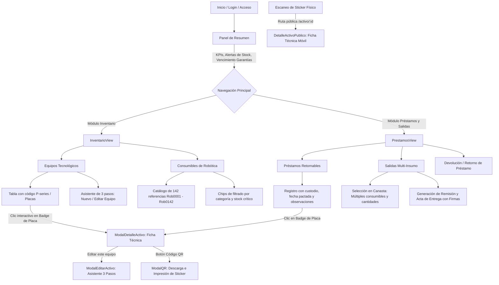

# SIGA - Módulo Frontend (Fundación Marina Orth)

Sistema de Información y Gestión de Activos (**SIGA**) diseñado para la **Fundación Marina Orth**. Esta aplicación web gestiona la trazabilidad completa del ciclo de vida de los equipos tecnológicos (laptops, tabletas, kits de robótica, proyectores) y consumibles/materiales utilizados en proyectos formativos y talleres STEAM en sedes educativas.

---

## 📋 Descripción General

El sistema centraliza las operaciones de inventario, préstamos con custodia institucional, salidas multi-insumo por canasta y generación de remisiones físicas oficiales con código QR.

- **Propósito**: Control de existencias en tiempo real, trazabilidad de responsables, prevención de pérdidas de material didáctico/tecnológico y estandarización de actas de entrega y devolución.
- **Identidad Visual Institucional**:
  - **Verde Lima Corporativo**: `#84CC16` / `rgb(132, 204, 22)` (acciones principales, badges activos, indicadores de éxito y acentos visuales).
  - **Azul Oscuro / Marino Institucional**: `#0B132B` y variantes `#0F172A` / `#1E293B` (superficies estructuradas, headers y contrastes).
  - **Tema Claro (Light Mode)**: Configurado como el tema predeterminado del sistema con persistencia opcional en almacenamiento local.

---

## 🛠️ Stack Tecnológico

- **React 18**: Biblioteca base para componentes declarativos y gestión de estado con hooks.
- **Vite 6 / 8**: Entorno de desarrollo ultrarrápido y empaquetador para producción.
- **Tailwind CSS & CSS Modules**: Diseño modular, clases de utilidad y compatibilidad con variables CSS para el sistema de temas.
- **Lucide React**: Iconografía vectorial uniforme y optimizada.
- **ExcelJS / xlsx**: Generación de reportes de inventario y libros maestros oficiales con estilos corporativos.
- **QRCode.react / HTML5 QR Scanner**: Generación e interpretación de códigos QR para placas físicas.

---

## 🔄 Diagrama de Flujo del Frontend

El siguiente diagrama detalla la interacción del usuario y la navegación a través de los distintos módulos:



---

## 📁 Arquitectura de Carpetas

La estructura interna de `src/` está organizada según separación de responsabilidades:

```text
src/
├── assets/                  # Imágenes institucionales, logos y recursos estáticos
├── components/              # Componentes visuales modulares y reutilizables
│   ├── layout/              # Header, Sidebar, Footer y contenedores de vistas
│   ├── modals/              # Ventanas emergentes de interacción clave
│   │   ├── ModalDetalleActivo.jsx  # Ficha técnica unificada (lectura de equipo)
│   │   ├── ModalEditarActivo.jsx   # Formulario wizard de 3 pasos unificado
│   │   ├── ModalEditarEquipo.jsx   # Alias de compatibilidad hacia ModalEditarActivo
│   │   └── ModalQR.jsx             # Visualización y descarga del código QR
│   └── ui/                  # Botones, inputs, badges y tarjetas de datos
├── context/                 # Contextos de React (ThemeContext, AuthContext, etc.)
├── hooks/                   # Custom hooks para encapsular lógica de estado y llamadas
├── pages/                   # Vistas principales de enrutamiento
├── services/                # Conexión con APIs backend y exportadores
│   ├── inventoryApi.js      # Servicios HTTP REST con Axios / Fetch hacia el backend
│   ├── mockData.js          # Datos de prueba, listado de sedes y proyectos FMO
│   └── excelExportService.js# Generación de reportes limpios con ExcelJS / xlsx
├── styles/                  # Hojas de estilo globales, variables de color e index.css
└── views/                   # Vistas de pantallas operativas
    ├── ResumenView.jsx      # Dashboard principal con métricas y alertas
    ├── InventarioView.jsx   # Gestión integral de equipos y consumibles
    ├── PrestamosView.jsx    # Préstamos en campo, salidas por canasta y actas
    ├── HistorialView.jsx    # Auditoría de movimientos históricos
    └── DetalleActivoPublico.jsx # Pantalla pública para escaneo rápido de QR
```

---

## 🚀 Instrucciones de Instalación y Uso

### 1. Requisitos Previos

- **Node.js**: Versión 18.0 o superior instalada.
- **Gestor de Paquetes**: `npm` v9+ (o `pnpm` / `yarn`).
- **Backend Activo**: Servicio Express / API REST corriendo en local o remoto.

### 2. Configuración del Entorno

Copia el archivo de ejemplo o crea un archivo `.env` en la raíz del frontend (`client/` o directorio raíz):

```env
# Variables de Supabase (si aplica para autenticación o base de datos directa)
VITE_SUPABASE_URL=tu_url_supabase
VITE_SUPABASE_ANON_KEY=tu_anon_key

# URL base de la API REST del backend
VITE_API_BASE_URL=http://localhost:3000
```

### 3. Comandos de Consola

Instala dependencias:
```bash
npm install
```

Ejecuta el servidor de desarrollo local:
```bash
npm run dev
```
> La aplicación estará disponible en `http://localhost:5173`. Para permitir acceso desde la red local (por ejemplo desde tabletas o celulares para escanear QR), usa:
> ```bash
> npm run dev -- --host
> ```

Construir la versión de producción optimizada:
```bash
npm run build
```

Previsualizar la compilación de producción:
```bash
npm run preview
```

---

## 📖 Guía Rápida para el Usuario Final

1. **Registrar un Equipo Tecnológico**:
   - En la barra lateral, haz clic en **Inventario**.
   - Presiona el botón verde **"+ Nuevo Equipo"**.
   - Completa el asistente de 3 pasos:
     1. *Identificación y Clasificación*: Código de placa, nombre, categoría, condición física y área.
     2. *Ficha Técnica*: Serial, marca, modelo, procesador, memoria RAM y ubicación física.
     3. *Adquisición y Credenciales*: Proveedor, valores de compra, fecha y credenciales de acceso.
   - Guarda los cambios. El equipo aparecerá disponible para préstamo.

2. **Consultar Ficha Técnica y Descargar Código QR**:
   - En cualquier tabla donde aparezca una placa (`ACT-FMO-001`, `P33`, etc.), haz clic directamente sobre el badge.
   - Se abrirá la ficha técnica completa con las especificaciones del equipo.
   - Haz clic en **"Código QR"** para generar la etiqueta lista para imprimir y adherir al equipo físico.

3. **Despachar Salidas Multi-Insumo (Canasta)**:
   - Dirígete al módulo **Préstamos y Salidas**.
   - Selecciona la pestaña **"Nueva Salida / Entrega"**.
   - Agrega a la canasta los consumibles requeridos indicando cantidades para cada referencia.
   - Asigna el responsable/custodio, la sede destino y el proyecto STEAM asociado.
   - Confirma el despacho para generar el acta de entrega.

4. **Impresión de Acta y Remisión Física**:
   - En el historial de entregas o al finalizar la remisión, haz clic en **"Imprimir Acta"**.
   - Se abrirá la vista de impresión con el membrete institucional de la Fundación Marina Orth, el desglose de insumos entregados y los espacios reglamentarios para firma de entrega y recibido.

---

## 📄 Licencia y Créditos

Desarrollado para la **Fundación Marina Orth** en apoyo a los programas de educación STEAM e innovación social en Colombia. Todos los derechos reservados.
